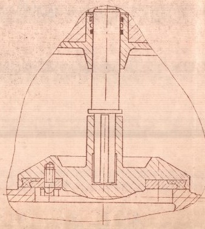
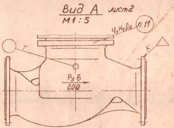

522-35.4479C6

Рис. 2

Остальное см. Рис. 1

27. Вероятность безотказной работы клапана... В течение периода непрерывной работы

5000 часов, апределенная расчетом 522-354150рр.

соствляет 0,97.

28. Показатели надежности на стадии производствд обеспечиваются выполнением ПОНП разрабатківдом заводом - изготовителем в соответствии с ГОСТ В15.206-84.

29.Исполнение OM5 ГОСТ15150-69.

30. Cmonopumb no PP.5.9307-79: no3.7,33u34, no3.31 -6ud 10.4.

31 * размеры для сподок.

<table border=1 style='margin: auto; word-wrap: break-word;'><tr><td style='text-align: center; word-wrap: break-word;'>Обоз начение</td><td style='text-align: center; word-wrap: break-word;'>Рис.</td><td style='text-align: center; word-wrap: break-word;'>Назначение</td><td style='text-align: center; word-wrap: break-word;'>Применяемые пункты п. т.</td><td style='text-align: center; word-wrap: break-word;'>Масса, кг</td></tr><tr><td style='text-align: center; word-wrap: break-word;'>522-35.4179</td><td style='text-align: center; word-wrap: break-word;'>1</td><td style='text-align: center; word-wrap: break-word;'>Р3, П3</td><td style='text-align: center; word-wrap: break-word;'>134,6,7-17,19-31</td><td style='text-align: center; word-wrap: break-word;'>119,0</td></tr><tr><td style='text-align: center; word-wrap: break-word;'>-01</td><td style='text-align: center; word-wrap: break-word;'>2</td><td style='text-align: center; word-wrap: break-word;'>П3</td><td style='text-align: center; word-wrap: break-word;'>134,7,10-13,15,16,18,19-31</td><td style='text-align: center; word-wrap: break-word;'>111,0</td></tr><tr><td style='text-align: center; word-wrap: break-word;'>-02</td><td style='text-align: center; word-wrap: break-word;'>2</td><td style='text-align: center; word-wrap: break-word;'>ТПФ</td><td style='text-align: center; word-wrap: break-word;'>25,10-13,15,18,21,24,29-31</td><td style='text-align: center; word-wrap: break-word;'>111,0</td></tr></table>

Присоединительные размеры фолонцев по ГОСТ 1536-76.

11. Маркировять по РД5.35. 9504-86, шрифтом/0.

12. Маркировять буквы шрифтом 70 гасте.304-81.

глубиной 0,5 мм, ширинд рисок 1 мм, алина

10 мм, глубиноя 0,5 мм. Риски и буквы залить

лаком ГОСТ 5631-79.

13 Обезживание, консервацию, расконсервацию, окраску, упаковку, транспортирование и хранение производить в соответствии с ост.1964-75. Класс покрытия ∇ ГОСТ.9.032-74.

14. Хранение клапанов в условиях „ЖЗ“ ГОСТ 15150-69, при этом допускается заводом изготовителям по согласованию с потребите-лем уточнять условия хранения при заключении договора на поставку клапанов.

15. Смазку трущихся поверхностей производить в соответствии с указаниями технического аписения и инструкции по эксплуотдуии.

16. Дет. по3.31,33,34 и 36 по 0CT5.9035-80.

17. Пакрытие дем. по3.33 КД9.фос. НГ-216А,

по3.34 и 37 КД12. фос. НГ-216А, по3.36- КД18. фос.

НГ-216А, по3.35 КД24. фос. НГ-216А по 4Н-

струкции 74-0603-68-81.

18. Покрымів dem. по3 37 Кд12. хр, по3. 35.

кд24. хр no OCT5.9048-85.

19. Число оборотов ма�овика при установке на невозврат " или закрытии -9,5 (Справ).

20. В момент запирдения запорного органа

блускдется применять ключ вспомогательни

по черт. 816-03. 106. Усилие не более 45 кес. три

одвлены ру

21. Тегнические требования к эстетике, чи-

стоте и культуре производства сборочных

цетов и участков по СП 35-71-76.

22 Ударостойкость кудапана соответствует требованиям "Норм ударостойкости..." 063-76,4.002 класс 2.

23. Вибростойкость клапана соответствует требованиям ОСТ В5, 4347-81, группа фесткости А_24. Коэффициент гидравлического сопротивления не более 6.

25. Общий уровень интенсивности воздушного шума, замеренный в соответствии сMKWC-71E, не пребышдет 70 дб.

26. Уровни составляющих спектра вибрации, измеренные в соответствии с нетодикой

МКШС-71Е, удовлетворяют требованиям №2.

106цие технические условия на поставку по

ОСТ5.5131-73 и ОСТВД5.5131-73.

2. Одшие теснические условия на поставку по ОСТ5.5131-73.

3. Асвления по гост 356-80.

4. Проводима среда-вода морская с температура от минус 2 до люс 50°C.

5. Проводимая среда-28% раствор хларистого кальция с температурой от минус 40 до пикос50°C.

6. Разбивка времени воздействия температуры и давления проводимой среды в соответствии с гарантийным протоколом согласования применения покупных изделий N*L-ПСП-4035-85

Назначенный срок службы до заводского ремонта - 13 лет, в том числе 10 лет с момента сдачи заказа. При этом количество циклоб сра-

Назначенный ресурс до списания - 120000 часов. Назначенный ресурс до заводского ремонта - 60000 часов.

Период непрерывной работы без обслужиба-ния - 5000 часов. В промежутках между периодами непрерывной работы допускается в условиях заказа проверка на функционирование и проведение технического обслуживания силами обслуживающего персонала без депонтажека и разборки.

9. В период срока случабы до списания клапан обеспечивает все свои характеристики после нагодения в течение 20 лет в нерабочем состоянии в уловиях законсервированного заказа при температуре окружающей среды от минус 45 до плюс 32° с и относительной влажности 30-40%, при этом комплектующие изделия и смазка, имеющие меньший срок хранения, подлежат замене.

<table border=1 style='margin: auto; word-wrap: break-word;'><tr><td colspan="2">СОБЛЮДАТЬ ТРЕБОВАНИЯ 01-1874-62</td></tr><tr><td style='text-align: center; word-wrap: break-word;'></td><td style='text-align: center; word-wrap: break-word;'></td></tr></table>

<table border=1 style='margin: auto; word-wrap: break-word;'><tr><td style='text-align: center; word-wrap: break-word;'></td><td style='text-align: center; word-wrap: break-word;'></td><td style='text-align: center; word-wrap: break-word;'></td><td style='text-align: center; word-wrap: break-word;'></td></tr><tr><td style='text-align: center; word-wrap: break-word;'>ПРЕДЕПРЕДЕННОВОТ ПОДПИН. ПОДПИН</td><td style='text-align: center; word-wrap: break-word;'>ДОРОВНИК</td><td style='text-align: center; word-wrap: break-word;'>120</td><td style='text-align: center; word-wrap: break-word;'>32 916</td></tr></table>

<table border=1 style='margin: auto; word-wrap: break-word;'><tr><td style='text-align: center; word-wrap: break-word;'>4</td><td style='text-align: center; word-wrap: break-word;'></td><td style='text-align: center; word-wrap: break-word;'>12221888 87</td><td style='text-align: center; word-wrap: break-word;'>200</td><td style='text-align: center; word-wrap: break-word;'>1111</td><td colspan="4">522-35.4179 C5</td></tr><tr><td style='text-align: center; word-wrap: break-word;'>3</td><td style='text-align: center; word-wrap: break-word;'></td><td style='text-align: center; word-wrap: break-word;'>250731387</td><td style='text-align: center; word-wrap: break-word;'>440</td><td style='text-align: center; word-wrap: break-word;'>2500</td><td style='text-align: center; word-wrap: break-word;'></td><td style='text-align: center; word-wrap: break-word;'></td><td style='text-align: center; word-wrap: break-word;'></td><td style='text-align: center; word-wrap: break-word;'></td></tr><tr><td style='text-align: center; word-wrap: break-word;'>2</td><td style='text-align: center; word-wrap: break-word;'>3m</td><td style='text-align: center; word-wrap: break-word;'>300131786</td><td style='text-align: center; word-wrap: break-word;'>4</td><td style='text-align: center; word-wrap: break-word;'>1116</td><td style='text-align: center; word-wrap: break-word;'>Клапн невозвратно</td><td style='text-align: center; word-wrap: break-word;'>1</td><td style='text-align: center; word-wrap: break-word;'>mm</td><td style='text-align: center; word-wrap: break-word;'>маса</td></tr><tr><td style='text-align: center; word-wrap: break-word;'>ИЗ</td><td style='text-align: center; word-wrap: break-word;'>Акст</td><td style='text-align: center; word-wrap: break-word;'>н докум</td><td style='text-align: center; word-wrap: break-word;'>подп</td><td style='text-align: center; word-wrap: break-word;'>Agd</td><td style='text-align: center; word-wrap: break-word;'>запорный проходни</td><td style='text-align: center; word-wrap: break-word;'>П</td><td style='text-align: center; word-wrap: break-word;'>см.</td><td style='text-align: center; word-wrap: break-word;'>нали</td></tr><tr><td style='text-align: center; word-wrap: break-word;'>Агъноб</td><td style='text-align: center; word-wrap: break-word;'>Пиргична</td><td style='text-align: center; word-wrap: break-word;'>Пиггина</td><td style='text-align: center; word-wrap: break-word;'>Пиг</td><td style='text-align: center; word-wrap: break-word;'>Пу200</td><td style='text-align: center; word-wrap: break-word;'>флючевый оронзобый</td><td style='text-align: center; word-wrap: break-word;'>П</td><td style='text-align: center; word-wrap: break-word;'>тайн</td><td style='text-align: center; word-wrap: break-word;'>1:2</td></tr><tr><td style='text-align: center; word-wrap: break-word;'>Повод</td><td style='text-align: center; word-wrap: break-word;'>Горохов</td><td style='text-align: center; word-wrap: break-word;'>ПУ</td><td style='text-align: center; word-wrap: break-word;'>Пу200</td><td style='text-align: center; word-wrap: break-word;'>Сворочний чорнежк</td><td style='text-align: center; word-wrap: break-word;'>Пиг</td><td style='text-align: center; word-wrap: break-word;'>Пиг</td><td style='text-align: center; word-wrap: break-word;'>Пиг</td><td style='text-align: center; word-wrap: break-word;'>Пиг</td></tr><tr><td style='text-align: center; word-wrap: break-word;'>Т.конр</td><td style='text-align: center; word-wrap: break-word;'>Авсхэм</td><td style='text-align: center; word-wrap: break-word;'>Пиг</td><td style='text-align: center; word-wrap: break-word;'>Пу200</td><td style='text-align: center; word-wrap: break-word;'>Пу200</td><td colspan="4">Превприятия</td></tr><tr><td style='text-align: center; word-wrap: break-word;'>Вычислях</td><td style='text-align: center; word-wrap: break-word;'>Коротков</td><td style='text-align: center; word-wrap: break-word;'>Пу200</td><td style='text-align: center; word-wrap: break-word;'>Пу200</td><td style='text-align: center; word-wrap: break-word;'>Пу200</td><td colspan="4">Превприятия</td></tr></table>